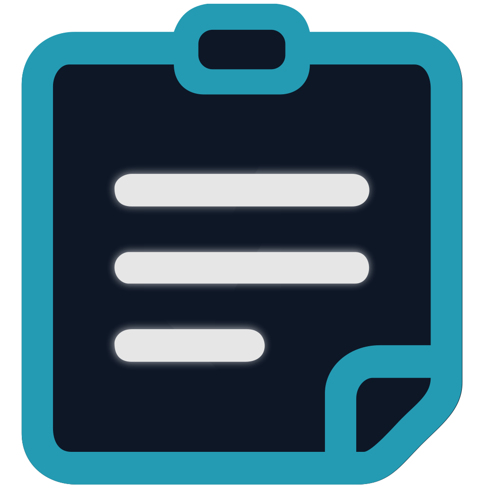

<p align="center">
  
</p>

## 📰 CyberNotes {{VERSION}}: Release Notes

### 🚀 What's new in this release

<!-- IMPORTANT FOR AGENTS & MAINTAINERS: Always rewrite this entire section and highlights with the ACTUAL release notes for this specific new version before tagging. NEVER leave or copy previous version notes! Use 25-45 words for the summary, lead with user-facing changes, and do not repeat the app name or version. -->
<!-- changelog-summary:start -->
Floating notes gain dedicated settings, default colors, sizes, and a customizable global shortcut. Inline images offer seamless Word-style selection and caret navigation, editor hotkeys eliminate double modifiers, and tabs feature smooth hover marquees.
<!-- changelog-summary:end -->

> **New to CyberNotes?** A privacy-focused Windows notes app with rich text, folders, tabs, floating notes, and fully local data.

---

### ✨ Key Features & Highlights

- 📌 **Dedicated floating notes settings & global shortcut**: customize default color (with random), opacity, pinned state, window size, and launch new notes anywhere via an editable, disableable `Alt+Shift+F` global shortcut.
- 🎨 **Expanded 10-color palette**: new Cyber Red color completes a balanced 5x2 swatch grid in the floating note color picker, featuring uniform circular swatches.
- 🖼️ **Word-style inline images & selection**: natural caret placement before and after images with native blinking, lateral click positioning, Shift+Arrow multi-element range selection, and refined click frames.
- ⌨️ **Streamlined editor hotkeys**: double modifiers eliminated across all 29 toolbar actions (`Ctrl+D` strikethrough, `Alt+C` code block), with new dedicated single-modifier shortcuts for tables, media, symbols, and emojis.
- 🏷️ **Tab title hover marquee**: hovering over long tab names smoothly scrolls the full title into view with exact fade mask clearance.
- ⚙️ **Refined settings & modern artwork**: embedded search bar directly in the settings sidebar, standardized enter badge glyphs, harmonized controls, and refreshed installer sidebar artwork.

<details>
<summary><b>🇪🇸 Ver notas de la versión en Español</b></summary>

### 🚀 Novedades de esta versión

<!-- Maintainer: Espejo en español del resumen de arriba. Mismo rango (25-45 palabras), cambios visibles primero, sin repetir el nombre de la app ni la versión. -->
Las notas flotantes suman pestaña de configuración dedicada, colores y tamaños predeterminados y atajo global personalizable. Las imágenes integradas adoptan selección y cursor fluidos estilo Word, los atajos del editor eliminan modificadores dobles y las pestañas estrenan marquesina al pasar el ratón.

---

### ✨ Novedades destacadas

<!-- Maintainer: Espejo en español de los puntos de arriba. -->

- 📌 **Ajustes dedicados y atajo global para notas flotantes**: personaliza color inicial (con opción aleatoria), opacidad, fijado, tamaño de ventana y crea notas desde cualquier lugar con el atajo global editable y desactivable `Alt+Shift+F`.
- 🎨 **Paleta ampliada a 10 colores**: nuevo color Rojo Ciber que completa una cuadrícula equilibrada de 5x2 en el selector de notas flotantes, con muestras circulares uniformes.
- 🖼️ **Imágenes integradas y selección estilo Word**: posición natural del cursor antes y después de imágenes con parpadeo nativo, clic lateral, selección con Shift+Flechas para texto e imágenes y marco de selección refinado.
- ⌨️ **Atajos de barra simplificados**: modificadores dobles eliminados en las 29 acciones de la barra (`Ctrl+D` tachado, `Alt+C` bloque de código) y nuevos atajos simples para tablas, video, símbolos y emojis.
- 🏷️ **Marquesina en títulos de pestañas**: pasar el ratón sobre títulos largos desplaza suavemente el texto completo con precisión milimétrica sobre la máscara de degradado.
- ⚙️ **Ajustes refinados y arte del instalador**: barra de búsqueda integrada en la barra lateral de configuración, botón Enter estandarizado, controles armonizados y arte de instalador modernizado.

### ⚠️ Antes de instalar

- **Windows:** esta versión aún no está firmada digitalmente. SmartScreen puede avisar antes de ejecutarla: **Más información › Ejecutar de todas formas**. Cuando Smart App Control está activado, Windows rechaza programas sin firmar; consulta la [política de firma de código](https://github.com/CyberGems/.github/blob/main/CODE_SIGNING.md). Verifica la descarga con los checksums SHA256 que aparecen más abajo.

</details>

---

### ⚠️ Before you install

- **Windows:** this release is not code-signed yet. SmartScreen may ask before it runs: **More info › Run anyway**. Where Smart App Control is on, Windows refuses unsigned programs; see the [code signing policy](https://github.com/CyberGems/.github/blob/main/CODE_SIGNING.md). Verify the download with the SHA256 checksums below.

---

### 📦 Downloads & Packages

> ⬇️ **Direct download:** click a file name to download it now. Same files as in **Assets** at the bottom of this page.

| File | Description | Platform |
| :--- | :--- | :--- |
| **[`CyberNotes_Setup_{{RAW_VERSION}}.exe`](https://github.com/CyberGems/CyberNotes/releases/download/{{VERSION}}/CyberNotes_Setup_{{RAW_VERSION}}.exe)** | 🚀 **Recommended Installer** (NSIS wizard, custom install dir, Start Menu + Desktop shortcuts) | Windows 10 / 11 (x64) |
| **[`CyberNotes_Portable_{{RAW_VERSION}}.exe`](https://github.com/CyberGems/CyberNotes/releases/download/{{VERSION}}/CyberNotes_Portable_{{RAW_VERSION}}.exe)** | Portable build (zero-install) | Windows 10 / 11 (x64) |

---

### 🔐 VirusTotal and SHA256

> 🛡️ The report opens on VirusTotal and does not download anything.

**Installer**: [View VirusTotal report](https://www.virustotal.com/gui/file/{{INSTALLER_HASH}})

```text
{{INSTALLER_HASH}}
```

**Portable**: [View VirusTotal report](https://www.virustotal.com/gui/file/{{PORTABLE_HASH}})

```text
{{PORTABLE_HASH}}
```

---

*Crafted with precision by [CyberGems](https://cybergems.org)*
